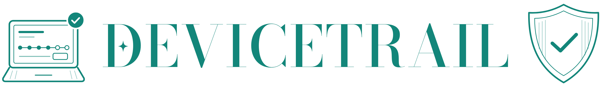
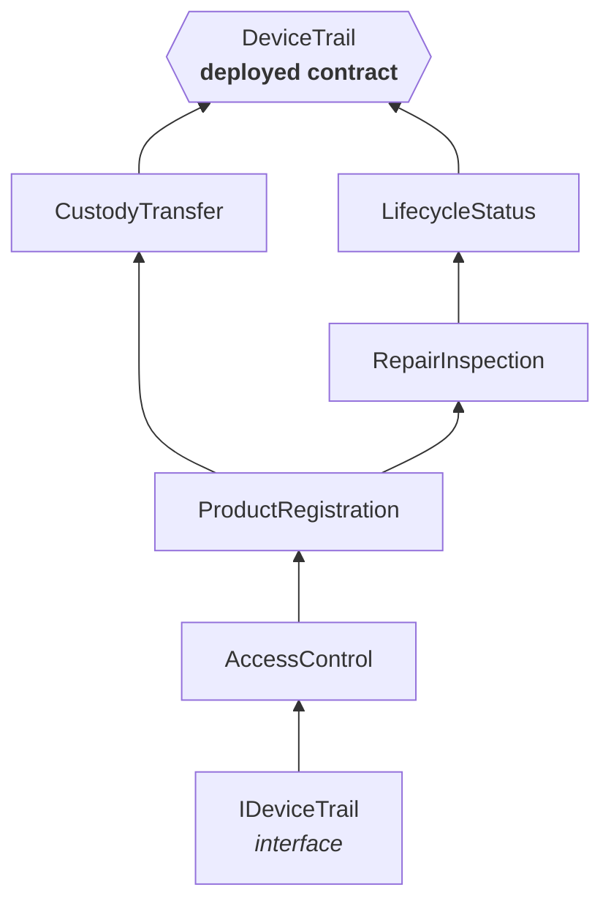

<div align="center">



# DeviceTrail: Blockchain Provenance for Refurbished Electronics

*Every refurbished laptop has a past. One scan shows a device's complete history, from the factory to the buyer.*

<br>


**CSE 540 · Engineering Blockchain Applications · Fall B 2026 · Team 5**

[How it works](#-how-it-works) ·
[Quick start](#-quick-start) ·
[The website](#-the-website) ·
[Smart contracts](#-smart-contracts) ·
[Team](#-team)

</div>

---

## 💡 The problem

You buy a "certified refurbished" laptop. Was the battery really replaced? Who inspected it? Has it changed hands five times or once?

You have to take the seller's word for it. Repair logs sit in private databases that can be incomplete or quietly edited, and the buyer, the person with the most at stake, sees none of them.

## ✨ The solution

DeviceTrail records each step in a device's life on an Ethereum smart contract, and **only the stakeholder responsible for a step can record it**:

| | |
|---|---|
| 🏭 **Register** | The manufacturer gives each device a unique ID. Duplicates are rejected. |
| 🚚 **Transfer** | Custody moves between stakeholders, and only the current holder can hand it on. |
| 🔧 **Repair** | The refurbisher logs every repair and replaced component. |
| 🔍 **Inspect** | An independent inspector certifies the device. Only the report's SHA-256 hash goes on-chain, so the report stays private but any copy of it can be checked. |
| 🏷️ **Sell** | The retailer lists the device and marks it sold. |
| 📱 **Verify** | The buyer scans a QR code and sees the full, tamper-evident history. No wallet needed. |

---

## 🧭 How it works

A device moves through six lifecycle stages **in a fixed order**. It can't skip a stage, go back, or change after it is sold.


Every move also requires the caller to **hold the device**. The admin assigns roles and nothing more, so even the admin cannot rewrite a device's history.

### 👥 Who can do what

| Role | Can do |
|---|---|
| **Admin** | Assign roles to stakeholders |
| **Manufacturer** | Register devices, ship them |
| **Distributor** | Move devices in transit |
| **Refurbisher** | Start refurbishing, log repairs, mark devices inspected |
| **Inspector** | Certify an inspection report hash (without needing custody) |
| **Retailer** | List devices for sale, mark them sold |
| **Buyer** | Read everything, with no account or wallet |

### 🛡️ Rules the contract enforces

- ❌ The same device ID can't be registered twice
- ❌ Someone who isn't holding the device can't transfer it
- ❌ The wrong role can't log a repair or change a status
- ❌ A device can't be marked `Inspected` until an inspector has certified it
- ❌ One inspection report can't be reused for a second device
- ❌ A stage can't be skipped or reversed

Each rejection has a specific revert message, for example `Only the current custodian` or `Invalid status transition`.

---

## 🚀 Quick start

**Prerequisites:** Node.js 18+ and npm. MetaMask is needed only for the partner page.

```bash
# 1. Install and compile
git clone https://github.com/Khwahish29/DeviceTrail.git
cd DeviceTrail
npm install
npm run compile

# 2. Start a local blockchain (keep this terminal open)
npm run node

# 3. In a second terminal: deploy and assign roles
npm run deploy:local

# 4. (Optional) Take a sample laptop through its whole lifecycle
npx hardhat run scripts/demo-lifecycle.js --network localhost

# 5. Start the website
cd frontend
npm install
npm run dev
```

Open the URL Vite prints (usually **http://localhost:5173**) and look up `LAPTOP-SN-001`.

> [!TIP]
> If you restarted the node or deployed more than once, copy the contract address that `deploy:local` printed into [`frontend/src/config.js`](frontend/src/config.js).

The deploy script gives each local test account one role:

| Account | 0 | 1 | 2 | 3 | 4 | 5 |
|---|---|---|---|---|---|---|
| **Role** | Admin | Manufacturer | Distributor | Refurbisher | Inspector | Retailer |

---

## 🌐 The website

| Page | What it's for |
|---|---|
| **Home** `#/` | Look up any device by ID |
| **Device report** `#/device/<id>` | Status, journey, current holder, repairs, inspections, report check, full history, plus a printable, shareable QR code |
| **For manufacturers** `#/partners` | Sign in with MetaMask and register devices |

---

## 📜 Smart contracts

The deployed `DeviceTrail` contract is built from small modules, each with its own tests and docs:



| Module | Key functions | Docs |
|---|---|---|
| [`AccessControl`](contracts/AccessControl.sol) | `assignRole`, `getRole` | [ACCESS_CONTROL.md](docs/ACCESS_CONTROL.md) |
| [`ProductRegistration`](contracts/ProductRegistration.sol) | `registerProduct`, `getProduct` | [PRODUCT_REGISTRATION.md](docs/PRODUCT_REGISTRATION.md) |
| [`CustodyTransfer`](contracts/CustodyTransfer.sol) | `transferCustody` | [CUSTODY_AND_QR.md](docs/CUSTODY_AND_QR.md) |
| [`RepairInspection`](contracts/RepairInspection.sol) | `addRepairRecord`, `certifyInspection`, `verifyInspectionReport` | [REPAIR_INSPECTION.md](docs/REPAIR_INSPECTION.md) |
| [`LifecycleStatus`](contracts/LifecycleStatus.sol) | `updateStatus` | — |
| [`DeviceTrail`](contracts/DeviceTrailImpl.sol) | Combines all of the above | [DEPLOYMENT.md](docs/DEPLOYMENT.md) |

**Events:** `RoleAssigned` · `ProductRegistered` · `CustodyTransferred` · `RepairRecorded` · `InspectionCertified` · `StatusUpdated`. The website rebuilds each device's history from these events.

---

## 🧪 Testing

```bash
npm test          # 124 smart contract tests
npm run test:qr   # 4 QR generator tests
```

The tests run on Hardhat's in-memory network, so you don't need `npm run node` running.

---

## 🗂️ Project structure

```text
DeviceTrail/
├── contracts/          Solidity modules, the interface, and test mocks
├── test/               Hardhat tests, one file per module
├── scripts/
│   ├── deploy.js           deploy + assign roles, writes deployed.json
│   └── demo-lifecycle.js   take LAPTOP-SN-001 from registration to sale
├── frontend/           React + Vite + ethers buyer-facing site
├── qr/                 QR code generator and a standalone verify page
└── docs/               Per-module design notes
```

## 🛠️ Tech stack

| Layer | Technology |
|---|---|
| Blockchain | Ethereum (local Hardhat network) |
| Smart contracts | Solidity 0.8.28 |
| Development and testing | Hardhat, Hardhat Toolbox, Mocha/Chai |
| Frontend | React 18, Vite 5 |
| Blockchain client | ethers.js v6, MetaMask |
| QR codes | `qrcode` |
| Report integrity | SHA-256 hashes stored on-chain |

---

## 👩‍💻 Team

<div align="center">

**CSE 540 – Team 5**

Khwahish Patel · Prakruti Dangi · Kaushha Trivedi · Meet Patel · Harsh Modi

</div>

---

<div align="center">
<sub>Built for educational purposes as part of CSE 540 – Engineering Blockchain Applications.</sub>
</div>
